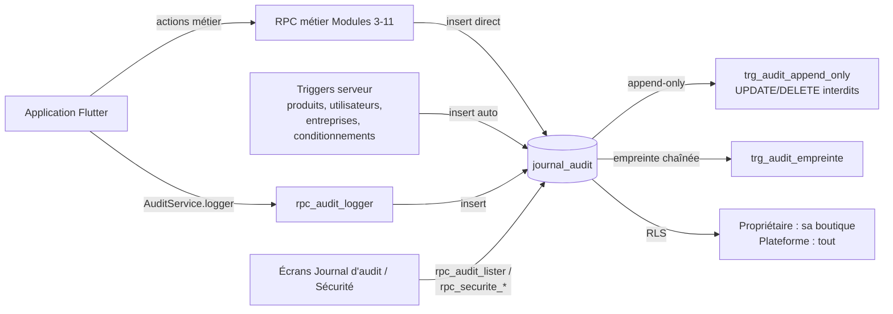

# MODULE 12 — ANALYSE DES ACTIONS À TRACER (étape 1)

> Document d'analyse produit le **2026-09-17** par sondage réel de la base
> Supabase (`pqzcliibocndiyqbyddr.supabase.co`, compte super-admin) et lecture
> des migrations des Modules 1→11.
>
> Objectif : identifier TOUT ce qui doit figurer dans `public.journal_audit`,
> repérer les angles morts, et préparer la migration
> `20260916000013_module12_audit_securite.sql` (+ le service `AuditService`).

---

## 1. ÉTAT DES LIEUX — LA TABLE `journal_audit` AUJOURD'HUI

Sondage REST (lecture) : la table existe et est **déjà alimentée**.

| Colonne | Type | État |
|---|---|---|
| `id` | uuid | présent (généré par les RPC via `gen_random_uuid()`) |
| `utilisateur_id` | uuid | présent (NULL pour les tentatives hors session) |
| `entreprise_id` | uuid | présent (NULL pour ventes/stock/finance : la boutique est dans `details.boutique`) |
| `action` | text | présent (codes en MAJUSCULES, cf. §3) |
| `details` | jsonb | présent |
| `ip_address` | text | **présent** (déjà renseigné à NULL) |
| `created_at` | timestamptz | présent |

**Manques identifiés :** pas de `niveau` (CRITIQUE/HAUT/MOYEN/INFO), pas de
`seq` (ordre total fiable), pas de `empreinte` (inaltérabilité vérifiable),
pas de garde append-only, pas de politique de lecture cloisonnée entreprise.

---

## 2. CE QUI EST DÉJÀ TRACÉ (Module par Module)

| Module | Action journalisée | Code action | Où c'est écrit |
|---|---|---|---|
| 3 | Création d'entreprise | `CREATION_ENTREPRISE` | trigger `trg_entreprises_audit_creation` |
| 3 | Changement de statut d'entreprise | `CHANGEMENT_STATUT` | trigger `trg_entreprises_audit_statut` |
| 3/4 | Paiement d'abonnement | `PAIEMENT_ENREGISTRE` | RPC `rpc_abonnement_enregistrer_paiement` |
| 3/4 | Réactivation après paiement | `REACTIVATION` | RPC `rpc_abonnement_reactiver` |
| 4 | Changement de rôle d'un utilisateur | `CHANGEMENT_ROLE` | trigger `trg_utilisateurs_audit_role` |
| 4 | Permissions d'un rôle modifiées | `PERMISSIONS_MODIFIEES` | RPC `rpc_permissions_set` |
| 4 | Permissions d'un rôle réinitialisées | `PERMISSIONS_REINITIALISEES` | RPC `rpc_permissions_reset` |
| 8 | Vente encaissée | `VENTE` | RPC `rpc_vente_valider` |
| 9 | Entrée de stock | `APPROVISIONNEMENT` | RPC `rpc_stock_approvisionner` |
| 9 | Ajustement de stock | `AJUSTEMENT` | RPC `rpc_stock_ajuster` |
| 9 | Clôture d'inventaire | `INVENTAIRE` | RPC `rpc_inventaire_cloturer` |
| 10 | Dépense créée / supprimée | `DEPENSE` (`details.suppression`) | RPC `rpc_depense_creer` / `_supprimer` |
| 10 | Clôture de caisse | `CLOTURE_CAISSE` | RPC `rpc_caisse_cloturer` |
| 10 | Dette créée | `DETTE` | RPC `rpc_dette_creer` |
| 10 | Paiement de dette | `PAIEMENT_DETTE` | RPC `rpc_dette_paiement` |
| 10 | Relance client | `RELANCE_DETTE` | RPC `rpc_dette_relancer` |
| 11 | Génération / export de rapport | `RAPPORT` | RPC `rpc_rapport_tracer` |

## 3. ANGLES MORTS IDENTIFIÉS (à combler par le Module 12)

| # | Angle mort | Gravité | Solution Module 12 |
|---|---|---|---|
| 1 | **Connexions / déconnexions / tentatives échouées** : aucune trace | MOYEN | `rpc_audit_logger` (anon autorisé pour `CONNEXION_ECHEC`) + appels `AuditService` |
| 2 | **Création / modification / suppression d'article** : aucune trace | MOYEN / HAUT | triggers `AFTER INSERT/UPDATE/DELETE` sur `produits` |
| 3 | **Modification de PRIX** (produits, conditionnements) : seule la protection VENDEUR existe, rien n'est journalisé | CRITIQUE | trigger prix renforcé (seul PROPRIÉTAIRE) + `PRIX_MODIFIE` avec ancien/nouveau |
| 4 | **Modification directe du stock** (`produits.quantite` sans mouvement) : non tracée | HAUT | trigger `STOCK_MODIFIE` quand l'écriture ne vient PAS d'un mouvement (vente/appro/ajustement) |
| 5 | **Annulation d'une vente** : la fonction n'existe pas ; une suppression directe de `ventes` n'est pas protégée | CRITIQUE | `rpc_vente_annuler` (restaure le stock via `ajustements`, retire la caisse) + suppression directe bloquée |
| 6 | **Création / modification / suppression d'utilisateur** (hors rôle) | MOYEN / CRITIQUE | triggers sur `utilisateurs` (`UTILISATEUR_CREE/MODIFIE/SUPPRIME`, `CHANGEMENT_ACTIVATION`) |
| 7 | **Suppression d'entreprise** | CRITIQUE | trigger `ENTREPRISE_SUPPRIMEE` |
| 8 | **Import d'articles** (nouveau) | HAUT | `rpc_produits_importer` + `IMPORT_PRODUITS` |
| 9 | Conditionnements (emballages vendables) modifiés | MOYEN | triggers sur `conditionnements` |
| 10 | Lecture cloisonnée du journal (aujourd'hui : tout rôle `audit/voir` voit tout) | HS SÉCURITÉ | RLS : entreprise → ses lignes ; plateforme → tout |

## 4. CATALOGUE COMPLET & NIVEAUX (référence `public.audit_niveau`)

| Niveau | Actions |
|---|---|
| **CRITIQUE** | `CREATION_ENTREPRISE`, `CHANGEMENT_STATUT`, `REACTIVATION`, `CHANGEMENT_ROLE`, `PERMISSIONS_MODIFIEES`, `PERMISSIONS_REINITIALISEES`, `PRIX_MODIFIE`, `ANNULATION_VENTE`, `UTILISATEUR_SUPPRIME`, `ENTREPRISE_SUPPRIMEE`, `VENTE_SUPPRIMEE` |
| **HAUT** | `VENTE`, `PAIEMENT_ENREGISTRE`, `PAIEMENT_DETTE`, `DETTE`, `DEPENSE`, `CLOTURE_CAISSE`, `APPROVISIONNEMENT`, `AJUSTEMENT`, `INVENTAIRE`, `STOCK_MODIFIE`, `ARTICLE_SUPPRIME`, `CHANGEMENT_ACTIVATION`, `IMPORT_PRODUITS` |
| **MOYEN** | `CONNEXION`, `DECONNEXION`, `CONNEXION_ECHEC`, `ARTICLE_CREE`, `ARTICLE_MODIFIE`, `CONDITIONNEMENT_AJOUTE`, `CONDITIONNEMENT_MODIFIE`, `CONDITIONNEMENT_SUPPRIME`, `UTILISATEUR_CREE`, `UTILISATEUR_MODIFIE`, `ENTREPRISE_MODIFIEE`, `RELANCE_DETTE` |
| **INFO** | `RAPPORT`, tout code inconnu (valeur par défaut) |

**Correspondance avec le tableau du cahier des charges :**

| Action exigée | Niveau exigé | Code Module 12 | Couverture |
|---|---|---|---|
| Créer entreprise | CRITIQUE | `CREATION_ENTREPRISE` | ✅ (existant + niveau) |
| Modifier prix | CRITIQUE | `PRIX_MODIFIE` | ✅ nouveau |
| Annuler vente | CRITIQUE | `ANNULATION_VENTE` | ✅ nouveau (RPC + écran) |
| Modifier stock (ajustement) | HAUT | `AJUSTEMENT`, `STOCK_MODIFIE` | ✅ (existant + nouveau) |
| Enregistrer paiement | HAUT | `PAIEMENT_ENREGISTRE`, `PAIEMENT_DETTE` | ✅ (existant + niveau) |
| Changer rôle utilisateur | CRITIQUE | `CHANGEMENT_ROLE` | ✅ (existant + niveau) |
| Activer/suspendre compte | CRITIQUE | `CHANGEMENT_STATUT`, `CHANGEMENT_ACTIVATION` | ✅ (+ nouveau) |
| Connexion / déconnexion | MOYEN | `CONNEXION`, `DECONNEXION`, `CONNEXION_ECHEC` | ✅ nouveau |
| Modification article | MOYEN | `ARTICLE_MODIFIE` | ✅ nouveau |

## 5. ARCHITECTURE CIBLE

### Garanties appliquées

1. **Append-only strict** — triggers `BEFORE UPDATE OR DELETE` qui lèvent
   `AUDIT_INALTERABLE`, policies RLS sans édition, `REVOKE` des écritures
   directes. Les RPC `security definer` restent la seule voie d'écriture.
2. **Preuve d'intégrité** — chaque ligne reçoit une **empreinte SHA-256
   chaînée** (empreinte précédente + contenu de la ligne). La fonction
   `rpc_audit_verifier()` recalcule la chaîne et détecte toute altération.
3. **Log AVANT validation** — pour les actions CRITIQUE (annulation de vente,
   prix, rôles, abonnements), l'insertion du journal précède la modification
   de l'état, dans **la même transaction** : si l'action échoue, rien n'est
   écrit ; si elle réussit, la trace existe forcément.
4. **Scoping de lecture** — la RLS distingue :
   * plateforme (`est_plateforme()` + `audit/voir`) → toutes les lignes ;
   * entreprise → lignes de SA boutique (`entreprise_id` ou `details.boutique`).
5. **IP** — relevée côté serveur depuis `request.headers` (x-forwarded-for,
   cf-connecting-ip, x-real-ip) par `public.audit_ip()` — jamais fournie par
   le client.

### Verrous de sécurité (rappel des exigences)

| Verrou | Règle serveur | Où |
|---|---|---|
| Prix | Seul **PROPRIÉTAIRE** (+ SUPER_ADMIN si réglage finance) modifie `prix_*` ; VENDEUR → `PRIX_INTERDIT_VENDEUR` | trigger `trg_produits_prix` |
| Stock | Update direct de `produits.quantite` réservé **MAGASINIER + PROPRIÉTAIRE** ; les mouvements (vente, appro, ajustement) passent par les triggers imbriqués | trigger `trg_produits_stock` |
| Abonnement | `verifier_action_sensible()` appelé par les RPC sensibles + middleware Dart `SecuriteService` | SQL + `securite_service.dart` |
| Permissions | Vérifiées côté serveur (`peut(...)`) ET côté app (middleware + `PermissionGate`) | inchangé, renforcé |

## 6. LIMITES ASSUMÉES & DOCUMENTÉES

- **IP** : best-effort (proxy Supabase fournit `x-forwarded-for` ; NULL si
  l'en-tête est absent). Les sondes SQL directes/appels service_role n'ont
  pas d'IP et ne sont pas traçables par l'application.
- **`auth.uid()` NULL** (SQL Editor, service_role) : les triggers
  n'appliquent pas les verrous de rôle (impossible de les attribuer) mais
  **journalisent** dès qu'ils le peuvent. C'est un canal administrateur.
- Les triggers d'audit sont **best-effort** (pattern Module 4) : une
  défaillance du journal ne doit jamais casser une opération métier — SAUF
  pour les RPC critiques du Module 12 où la trace fait partie de la
  transaction (annulation, import, prix via RPC).
- L'ancien `details.suppression` de `DEPENSE` reste accepté (rétro-compat).
