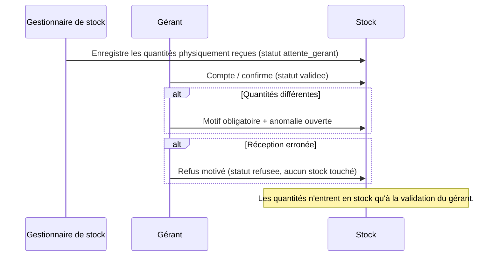
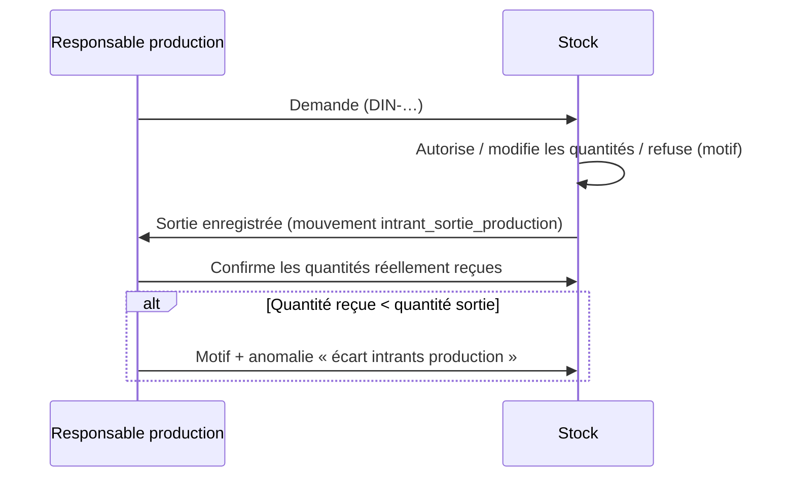
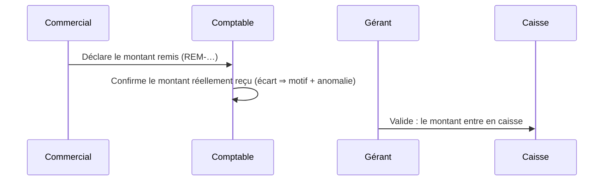

# Module 24 — Distribution : production, stock, terrain et caisse

Statut : **livré côté code**, migrations
`20260916000100_module24_distribution_gestion.sql` et
`20260916000101_module24_distribution_complements.sql`
à exécuter dans Supabase → SQL Editor.

Ce module ne remplace pas le module 23 (« tournées terrain ») : il ajoute le
système complet de **production et de distribution** demandé, avec ses propres
collaborateurs, son stock d'intrants séparé du stock de produits finis, ses
validations à plusieurs niveaux et sa caisse.

---

## 1. Les six rôles de la distribution

Le rôle **global** (`utilisateurs.new_role`) reste la matrice de l'application.
Le rôle **distribution** (`utilisateurs.role_distribution`) décide de ce que
chacun fait dans ce module :

| Rôle distribution | Ce qu'il fait |
| --- | --- |
| `proprietaire` | Tout : collaborateurs, stock, production, commerciaux, caisse, anomalies. |
| `gerant` | Supervise et **valide** : réceptions, remises, dépenses, anomalies. |
| `production` | Demande ses intrants, confirme leur réception, déclare les productions et les pertes. |
| `stock` | Enregistre les réceptions, autorise les sorties, compte les produits finis et les retours. |
| `commercial` | Demande sa dotation, gère SES clients, vend, facture, déclare ses retours et ses remises. |
| `comptable` | Réceptionne l'argent des commerciaux, tient la caisse et les dépenses. |

Le **propriétaire crée lui-même ses collaborateurs** depuis
`Distribution → Collaborateurs` : nom, e-mail (identifiant), téléphone, mot de
passe, rôle. Chaque compte est un vrai compte Auth ; aucun compte n'est partagé.
Plusieurs commerciaux sont possibles.

> Les contrôles sont faits **côté serveur** par `dist_role()` / `dist_exige()` :
> masquer un bouton dans l'interface ne suffit pas, chaque RPC vérifie le rôle.

---

## 2. Les deux stocks

`dist_intrants` (PET, caps, bouteilles vides, autres) et `dist_produits`
(fardes, petites bouteilles, gros bidons) sont **deux tables distinctes**.
Aucune confusion possible. Chaque mouvement de quantité passe par
`dist_mouvements` (nature, quantité signée, stock avant/après, référence,
motif, auteur, date).

Le stock d'un commercial est encore un autre monde : `dist_stock_commercial`.
Une unité attribuée à un commercial **sort** du stock central et n'est plus
disponible pour un autre.

---

## 3. Les circuits de validation

### Réception d'intrants — double confirmation

### Intrants de la production — demande, sortie, réception

### Production → produits finis

Le producteur déclare : intrants reçus, consommés, perdus, restants ;
produits fabriqués. **Une perte sans motif est refusée.**
Les produits finis restent en `attente_stock` : ils n'augmentent le stock
qu'après le comptage du gestionnaire de stock. Tout manque ouvre une anomalie.

### Dotation commerciale — trois acteurs

1. Le commercial demande des produits.
2. La production confirme les quantités qu'elle peut fournir (ou refuse, motif).
3. Le stock autorise la sortie (stock central ↓, stock commercial ↑).
4. Le commercial confirme ce qu'il a physiquement reçu (écart ⇒ anomalie).

### Retour de marchandises

Le commercial déclare son retour : les produits quittent **son** stock.
Le gestionnaire de stock compte et confirme ; alors seulement ils rentrent au
stock central. Un écart déclaré/compté ouvre une anomalie pour le gérant.

### Argent — trois confirmations

**Une vente ne crédite jamais directement la caisse.** Les crédits clients ne
sont jamais considérés comme de l'argent remis. La caisse
(`dist_caisse` + `dist_parametres.solde_initial`) ne se modifie que par des
mouvements : apport du propriétaire, remise validée, dépense validée.

### Dépenses

Créées par le comptable / gérant / propriétaire, elles restent `en_attente`
jusqu'à l'autorisation du gérant. Une dépense validée débite la caisse ; le
solde négatif est refusé sauf réglage explicite (`autoriser_solde_negatif`).

---

## 4. Écrans

| Écran | Route | Rôles |
| --- | --- | --- |
| Tableau de bord Production & distribution | `/main/distribution` | tous les rôles distribution |
| Stock (intrants / produits finis / réceptions) | poussé depuis le tableau de bord | stock, gérant, propriétaire |
| Production (demandes d'intrants / productions) | poussé | production, stock (réception), gérant |
| Espace commercial (produits, clients, ventes, retours, remises) | poussé | commercial, gérant, propriétaire |
| Caisse & dépenses (caisse, remises, dépenses) | poussé | comptable, gérant, propriétaire |
| Collaborateurs Distribution | poussé | propriétaire |
| Traçabilité (journal, lecture seule) | `/main/distribution/journal` | tous les rôles distribution |

Le tableau de bord présente **uniquement des données réelles** relues par
`dist_tableau_bord()` : intrants (total/PET/caps/bouteilles vides), produits
finis (fardes/bouteilles/bidons), produits attribués, demandes et validations
en attente, ventes, collecté non remis, montant reçu et validé, caisse,
dépenses du mois, anomalies, tournées en cours. Il affiche aussi la liste des
opérations en attente **et le rôle attendu** pour chacune.

La facture d'une vente contient la raison sociale réelle, le numéro, la date,
le commercial, le client, les lignes, les totaux, le payé et le crédit. Elle
est imprimable et partageable en PDF (`distribution_facture_pdf.dart`).

---

## 5. Tables

`dist_parametres`, `dist_intrants`, `dist_produits`, `dist_stock_commercial`,
`dist_mouvements`, `dist_receptions` + `dist_reception_lignes`,
`dist_demandes_intrants` + lignes, `dist_productions` +
`dist_production_intrants` + `dist_production_sorties`,
`dist_demandes_commercial` + lignes, `dist_clients`, `dist_ventes` + lignes,
`dist_retours` + lignes, `dist_remises`, `dist_caisse`, `dist_depenses`,
`dist_anomalies`, `dist_journal`, `dist_compteurs`.

## 6. RPC principales

- Collaborateurs : `dist_collaborateurs_lister`, `dist_collaborateur_creer`,
  `dist_collaborateur_maj`.
- Stock : `dist_stock_resume`, `dist_intrant_enregistrer`,
  `dist_produit_enregistrer`, `dist_stock_ajuster`, `dist_mouvements_lister`.
- Réceptions : `dist_reception_intrants_enregistrer`,
  `dist_reception_intrants_confirmer`, `dist_reception_intrants_refuser`,
  `dist_receptions_lister`.
- Demandes d'intrants : `dist_demande_intrants_creer`,
  `dist_demande_intrants_traiter`, `dist_demande_intrants_receptionner`,
  `dist_demandes_intrants_lister`.
- Production : `dist_production_enregistrer`, `dist_production_receptionner`,
  `dist_production_reintegrer`, `dist_productions_lister`.
- Commercial : `dist_demande_commercial_creer/confirmer/autoriser/receptionner`,
  `dist_demande_commercial_lister`, `dist_produits_catalogue`,
  `dist_mes_produits`, `dist_client_enregistrer`, `dist_clients_lister`,
  `dist_vente_enregistrer`, `dist_ventes_lister`, `dist_facture`,
  `dist_retour_declarer`, `dist_retours_lister`,
  `dist_retour_receptionner`.
- Argent : `dist_remise_declarer`, `dist_remise_receptionner`,
  `dist_remise_valider`, `dist_remises_lister`, `dist_caisse_resume`,
  `dist_caisse_apport`, `dist_depense_creer`, `dist_depense_valider`,
  `dist_depenses_lister`.
- Pilotage : `dist_tableau_bord`, `dist_validations`,
  `dist_anomalies_lister`, `dist_anomalie_resoudre`,
  `dist_parametres_definir`, `dist_journal_lister`.

---

## 7. Sécurité

- **Écritures uniquement par RPC** : toutes les tables ont la RLS activée et
  **aucune policy d'écriture**. Les helpers internes (`dist_bouger_*`,
  `dist_numero`, `dist_anomalie`, `dist_facture_json`…) sont révoqués pour
  `anon` **et** `authenticated`.
- Lecture : membres de l'entreprise. Le **commercial ne voit que ses clients,
  ses ventes et ses remises** ; un autre commercial ne peut pas lire ses
  données. La caisse et les anomalies sont réservées à la direction et au
  comptable.
- Chaque opération sensible écrit dans `dist_journal` (append-only par
  convention : aucune fonction ne le supprime).
- `dist_journal_lister` expose ce journal en **lecture seule** à tous les
  membres (auteur, rôle, action traduite, date, détails) : écran
  **Traçabilité**, alimenté aussi par le refus d'une réception
  (`dist_reception_intrants_refuser`, motif obligatoire).

---

## 8. Scénarios à tester dans l'application

1. Le propriétaire crée trois collaborateurs : gérant, stock, production.
2. Il ajoute deux commerciaux et un comptable.
3. Chaque rôle se connecte et n'ouvre que ce qui lui est permis.
4. Le stock crée PET / caps / bouteilles vides, puis enregistre une réception.
5. Le gérant confirme la réception ; le stock augmente.
6. Le producteur demande 2 000 PET / 2 000 caps / 2 000 bouteilles.
7. Le stock autorise ; le producteur confirme la réception.
8. Le producteur déclare une production avec 50 bouteilles perdues + motif.
9. Le stock compte 95 fardes sur 100 remises : anomalie créée.
10. Le commercial demande 30 fardes ; production confirme ; stock autorise ;
    commercial confirme.
11. Le commercial crée ses clients ; un second commercial ne les voit pas.
12. Vente de 10 fardes = 80 000 + 2 bidons = 24 000 → facture 104 000.
13. La caisse **ne bouge pas** après la vente.
14. Le commercial déclare 80 000 ; le comptable reçoit 78 000 avec motif ;
    le gérant valide : la caisse augmente du montant validé.
15. Une dépense de 50 000 validée diminue la caisse.
16. Les totaux du tableau de bord correspondent à ces opérations.

---

## 9. Limites assumées de cette version

- **Connexion requise** pour le module 24 : les écritures passent par des RPC
  Supabase (validation croisée entre plusieurs comptes impossible à garantir
  hors ligne). Le mode hors ligne existant (caisse, tournées du module 23) est
  conservé tel quel, et la consultation des écrans déjà chargés reste possible.
- Les quantités de production déclarées avant comptage restent en
  `attente_stock` : le stock central ne les voit pas (comportement voulu).
- Une production en `en_litige` se règle par la décision du gérant sur
  l'anomalie ; le stock n'est pas ré-augmenté automatiquement.
- Les échanges de bidons (récipient vendu / échangé / remplissage) sont
  vendus au prix du produit fini ; une grille de plusieurs tarifs par bidon
  pourra être ajoutée dans une version suivante.
- Le module 24 ne remplace pas les tournées du module 23 : les deux peuvent
  coexister. `dist_tableau_bord` lit `tournees` seulement si la table existe.

---

## 10. Séparation boutique ↔ distribution (ce qui change à l'écran)

Le module 24 n'est pas « un écran de plus » : c'est un **univers de travail**
distinct. Depuis cette version, l'application le sait et adapte la navigation.

### 10.1 Le stock de distribution n'est pas le stock de la boutique

| | Boutique (modules 5 / 9) | Distribution (module 24) |
| --- | --- | --- |
| Tables | `articles`, `stock`, `mouvements_stock` (SQLite + Supabase) | `dist_intrants`, `dist_produits`, `dist_stock_commercial`, `dist_mouvements`, `dist_receptions`… |
| Écran | `/main/stock`, `/main/articles` | Stock (poussé depuis `/main/distribution`) |
| Écriture | écrans du module 9 / ventes | RPC `dist_*` uniquement (aucune policy d'écriture) |
| Unités | article + conditionnement | intrants (PET, caps, bouteilles vides) **séparés** des produits finis (fardes, bouteilles, bidons) |
| Carte d'accueil | « Stock » (alertes d'articles) | masquée pour un compte de distribution |

Conséquence concrète : une réception d'intrants n'augmente **jamais** le stock
d'articles de la boutique, et une vente de boutique ne touche jamais
`dist_stock_commercial`. Les deux mondes ne partagent aucune ligne de stock.

### 10.2 Le commercial de distribution n'est pas le vendeur de la boutique

| | Vendeur (module 4) | Commercial distribution (module 24) |
| --- | --- | --- |
| Rôle | `utilisateurs.new_role = VENDEUR` | `utilisateurs.role_distribution = 'commercial'` (le rôle global n'est qu'un véhicule) |
| Portefeuille | clients de l'entreprise | **ses** clients (`dist_clients.commercial_id`), RLS : il ne voit que les siens |
| Marchandise | catalogue de la boutique | **son** stock (`dist_stock_commercial`), reçu du stock central après demande |
| Encaissement | caisse de la boutique | déclaration de remise → comptable → gérant ; la caisse ne bouge qu'à la validation |
| Accueil | cartes Ventes / Caisse / Clients | bandeau « Espace distribution » + module ; cartes boutique masquées |

### 10.3 Le tableau de bord du gérant / propriétaire de distribution

Un compte de l'univers distribution ne voit **pas** les statistiques de la
boutique :

1. à la place, un **bandeau « Espace distribution »** (rôle, opérations en
   attente, solde de la caisse de distribution, anomalies ouvertes), alimenté
   par `dist_tableau_bord()` ;
2. un geste principal **« Espace distribution »** (au lieu de « Vendre vite ») ;
3. les cartes de boutique (Stock, Ventes, Caisse, Articles, Rapports,
   Finance, Publications…) sont **masquées** ; restent le module, l'assistant
   IA et le suivi de l'abonnement ;
4. sur `/main/distribution`, le contenu est **adapté au rôle** : le gérant voit
   les validations et les deux stocks, le propriétaire voit tout, le
   commercial voit ses produits/clients/ventes, le comptable voit caisse,
   remises et dépenses.

### 10.4 Les tournées du module 23 s'effacent

Dès que le **module 24 est actif** dans le profil de l'entreprise (ou dès que
le compte a un rôle distribution), les cartes **Tournées**, **Ma tournée**,
**Consignes clients** et **Récipients & bonus** disparaissent de l'accueil, et
le bouton du mode rapide ouvre `/main/distribution` au lieu de
`/main/tournees`.

⚠️ Une entreprise de distribution qui n'a **pas** le module 24 garde ses
tournées : aucune régression, aucun écran vide.

### 10.5 Où c'est implémenté

- `lib/services/contexte_distribution.dart` : lit
  `utilisateurs.role_distribution` / `dist_actif`, expose `universDistribution`
  et `masquerTournees` (règles pures testables).
- `lib/ui/accueil/cartes_accueil.dart` : `CarteAccueil.visibles(...)` accepte
  `universDistribution` et `masquerTournees`.
- `lib/widgets/bandeau_distribution_accueil.dart` : bandeau du tableau de bord.
- `lib/pages/home_page.dart` : bandeau, cartes et actions rapides adaptés.
- `lib/pages/scaffold_with_nav_bar.dart` : chargement du contexte à l'entrée de
  l'espace entreprise.
- `test/univers_distribution_test.dart` : 7 cas (règles + grille d'accueil).

---

## 11. Tarifs, bonus / dommages et marges (migration `0103`)

### 11.1 Grille multi-tarifs des bidons (§9)

Table `dist_tarifs` (unique par `owner_id, produit_id, type_operation`) :

| `type_operation` | Sens commercial |
| --- | --- |
| `standard` | prix normal (repli) |
| `bidon_neuf` | bidon neuf avec eau |
| `eau_avec_echange` | eau + reprise d'un bidon vide |
| `remplissage` | remplissage du bidon du client |
| `bidon_vide` | vente d'un bidon vide |
| `remplacement_endommage` | remplacement d'un bidon endommagé |

RPC : `dist_tarif_enregistrer` (gérant / propriétaire) et
`dist_tarifs_lister`. Écran : **Stock → Produits finis → ⋮ → Grille tarifaire**.

⚠️ Une vente enregistrée garde ses prix : les lignes de vente figent
`prix_unitaire` et `total`. Changer la grille ne réécrit aucune facture.

**Appliquée en caisse (migration `0104`)** : `dist_vente_enregistrer` reçoit
`p_type_operation` et résout le prix ainsi : grille active (produit + type) →
grille `standard` → prix catalogue. Le prix retenu est figé dans
`dist_vente_lignes.prix_unitaire`, et `dist_ventes.type_operation` conserve la
nature de l'opération. L'écran de vente du commercial affiche le prix de la
grille et le total correspondant.

### 11.2 Bonus et produits endommagés (§10)

Table `dist_bonus_dommages` : `nature` ∈ `bonus | endommage | casse | perdu`,
quantité, prix unitaire figé, valeur, motif obligatoire, justificatif
facultatif, statut `en_attente → valide | refuse`.

- **Déclaration** : `dist_bonus_declarer` — un commercial ne déclare que pour
  lui-même ; la direction peut déclarer pour un autre.
- **Validation** : `dist_bonus_valider` (gérant / propriétaire). C'est
  **seulement là** que le stock du commercial baisse
  (`dist_bouger_commercial`, nature `bonus_commercial` ou `perte_commercial`).
  Aucun stock n'est touché tant que la déclaration est en attente ou refusée.
- **Comparaison** : `dist_bonus_resume` (direction + comptable) donne, par
  commercial, les bonus, les dommages et le total valorisé ; il est affiché
  dans l'onglet **Rentabilité** (« Bonus et dommages par commercial »).
- Écran : **Espace commercial → onglet « Bonus »** (déclaration + validation).

Les bonus ne sont **jamais** additionnés au chiffre d'affaires : ils apparaissent
en déduction séparée dans l'analyse de rentabilité.

### 11.3 Coût de revient et marges (§11)

- `dist_cout_revient(p_produit, p_limite)` : par produit, coût total des
  intrants **consommés + perdus** valorisés à `dist_intrants.prix_unitaire`,
  divisé par les quantités reçues au stock → coût unitaire, prix de vente,
  marge unitaire, marge %, date de dernière production.
- `dist_rentabilite(p_debut, p_fin)` : CA de la période, coût des
  marchandises vendues, marge brute, marge %, bonus/dommages validés, et
  détail par commercial.

**Aucune marge inventée** : si un intrant n'a pas de prix, `cout_complet` vaut
`false` et les marges sont renvoyées à `null`. L'interface doit alors afficher
« coûts incomplets » au lieu d'un chiffre.

**Écran** : *Caisse & dépenses → onglet « Rentabilité »* (propriétaire,
gérant, comptable) : marge brute du mois, CA, coût des marchandises, taux de
marge, bonus/dommages validés, coût de revient par produit et CA par
commercial, avec un avertissement explicite quand les coûts sont incomplets.

---

## 12. Hors-ligne du commercial (migration `0105`)

Le commercial travaille parfois sans réseau. Les opérations sont **d'abord
écrites dans une file locale**, puis rejouées au serveur.

### 12.1 Ce qui fonctionne hors ligne

| Action | Comportement |
| --- | --- |
| Consulter son stock attribué, ses clients, la grille tarifaire | lecture du **cache local** (dernier chargement réussi) |
| Enregistrer une vente | mise en file (`ajouterVente`), facture provisoire locale |
| Déclarer un bonus / dommage | mise en file (`ajouterBonus`) |
| Retours, remises, encaissements | **restent en ligne** (validations croisées) |

### 12.2 Garanties

- **Identifiant unique par opération** : UUID généré sur l'appareil, envoyé
  comme `reference_locale`. La base possède un index unique partiel et renvoie
  l'opération existante au lieu de la recréer (`0105`) → une synchronisation
  rejouée ne crée ni double vente ni double bonus.
- **Pas de reprise silencieuse** : si l'envoi est interrompu (réponse perdue),
  l'opération passe en **« à vérifier »** et n'est plus jamais rejouée
  automatiquement ; le commercial contrôle sa liste puis clique sur
  « Relancer ».
- **Refus métier** (stock insuffisant, produit inconnu, motif manquant) :
  l'opération passe en **conflit** avec le message du serveur, et la file
  s'arrête (les opérations suivantes peuvent en dépendre).
- **Le serveur reste la source de vérité** : la file ne fait que rejouer des
  intentions ; aucun stock n'est décrémenté localement en double.

### 12.3 Écran

Un **bandeau orange** apparaît en haut de l'espace commercial dès qu'une
opération attend ou que l'écran tourne sur le cache : nombre d'opérations,
bouton **Synchroniser** (ou **Réessayer**), et repli automatique sur les
données mémorisées quand le chargement échoue.

### 12.4 Limites assumées

- La **création de client hors ligne** n'est pas encore mise en file : une
  vente hors ligne se fait « client comptant » (nom conservé dans la file).
- Les **encaissements/remises** et les **validations** restent strictement en
  ligne (règle du module : l'argent ne circule qu'entre deux comptes).
- La facture produite hors ligne est **provisoire** : le numéro définitif est
  attribué par le serveur à la synchronisation.
