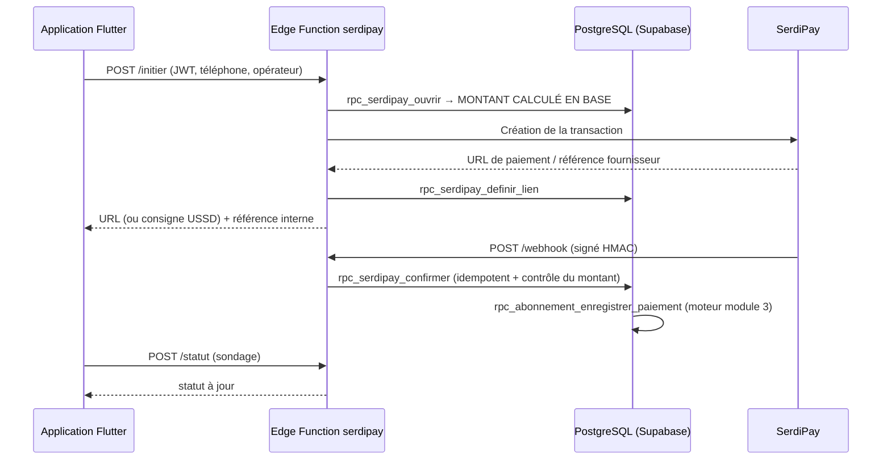

# Passerelle de paiement SerdiPay — intégration Biashara Yangu

> **Statut** : code livré côté dépôt (migration `79`, Edge Function `serdipay`,
> écran Flutter). **Rien n'est actif tant que le déploiement n'est pas fait**
> (voir §5) et que SerdiPay n'a pas fourni ses identifiants (§2).

---

## 0. Où en est-on ? (30/10/2026)

SerdiPay a envoyé : **ID API `APIWY4G2W9`**, les **routes** (§2.1) et les accès au
**back-office** (`https://app.serdipay.com`, code marchand **`066036`**,
identifiant + mot de passe + PIN).

> 🔐 L'identifiant, le mot de passe et le PIN **ne doivent jamais être écrits
> dans le code ni envoyés par messagerie** : ils se saisissent uniquement dans
> les secrets Supabase.

Quatre actions, dans cet ordre :

| # | Action | Où | État |
|---|---|---|---|
| 1 | Faire déclarer l'IP **`213.130.145.53`** | message à SerdiPay | ⏳ à faire |
| 2 | Déposer `relais.php` + `.htaccess` à jour | Hostinger → `public_html/serdipay/` | ⏳ à faire |
| 3 | Créer les secrets `SERDIPAY_USERNAME`, `SERDIPAY_PASSWORD`, `SERDIPAY_WEBHOOK_SECRET` | Supabase → Edge Functions → Secrets | ⏳ à faire |
| 4 | Coller `index.ts` puis **Deploy** la fonction `serdipay` | Supabase → Edge Functions | ⏳ à faire |

Puis, **sans rien saisir de plus**, on lance le diagnostic qui découvre tout seul
la forme exacte attendue par `get-token` :

```bash
curl -s -X POST -H "x-relais-token: <JETON_RELAIS>" \
  https://pqzcliibocndiyqbyddr.supabase.co/functions/v1/serdipay/diag-token
```

Il renvoie, pour chaque forme de corps essayée, le **statut HTTP** et la
**réponse brute** de SerdiPay. Le premier `200` donne la forme à retenir
(elle est déjà celle par défaut si c'est la n°1).

**Contrôle du relais** (indépendant de Supabase) :

```bash
curl -s -o /dev/null -w "%{http_code}\n" \
  -X POST -H "Content-Type: application/json" -d '{}' \
  https://serdipay.biasharagroup.com/api/public-api/v1/merchant/get-token
```

| Réponse | Signification |
|---|---|
| `503` | `relais.php` sur le serveur est encore l'ancien (à redéposer) |
| `401` | jeton de relais absent/invalide (appel direct sans `x-relais-token`) |
| `400 … not whitelisted` | dépôt OK, **IP pas encore autorisée chez SerdiPay** |
| `400` avec un autre message | ✅ IP autorisée — il reste à remplir la clé |
| `200` | ✅ jeton obtenu |

---

## 1. Ce que fait l'intégration



**Trois garanties importantes :**

| Risque | Parade |
|---|---|
| Client qui paie moins cher | Le montant n'est **jamais** transmis par l'app : `rpc_serdipay_ouvrir` le lit dans `entreprises.solde_restant` / `factures_abonnement.solde_restant`. |
| Webhook falsifié / offert | Signature HMAC-SHA256 obligatoire. Sans `SERDIPAY_WEBHOOK_SECRET`, le webhook répond **503** ; signature fausse → **401**. |
| Double crédit (webhook rejoué) | `reference` unique + `select … for update` + transition `en_attente → paye` unique. Un rejeu répond `{ok:true, deja:true}` sans recréditer. |

---

## 2. Ce que SerdiPay doit vous fournir

### 2.1 Ce qui a été reçu le 30/10/2026

| | Production | Mise en scène |
|---|---|---|
| Base | `https://public-apis.services.serdipay.com` | `https://apis.serdipay.cloud` |
| Obtenir un jeton | `POST /api/public-api/v1/merchant/get-token` | idem |
| Paiement C2B (encaisser) | `POST /api/public-api/v1/merchant/payment-merchant` | idem |
| Décaissement B2C (payer) | `POST /api/public-api/v1/merchant/payment-client` | idem |

**ID API : `APIWY4G2W9`** (identifiant public, pas un secret).

> ⚠️ **IP obligatoire** — l'API répond
> `{"message":"This domain or IP (x.x.x.x) is not whitelisted"}` tant que
> l'adresse appelante n'est pas déclarée. Nos appels passent donc par le
> **relais à IP fixe** `https://serdipay.biasharagroup.com/api` (serveur
> **213.130.145.53**, Hostinger). C'est cette IP qu'il faut faire déclarer.

### 2.2 Contrat de `get-token` — ✅ CONFIRMÉ le 30/10/2026

Tests réels effectués **depuis le relais** (IP `213.130.145.53`, déjà déclarée
chez SerdiPay) :

| Corps envoyé | Réponse de SerdiPay |
|---|---|
| `{}` | `400` `{"message":"Validation Error","errors":{"email":["validation.required"],"password":["validation.required"]}}` |
| `{"email":"essai@example.com","password":"motdepassebidon"}` | `401` `{"message":"Invalid Credentials"}` |

**Conclusion** : `POST /api/public-api/v1/merchant/get-token` attend **deux
champs seulement** : `email` et `password` (identifiants du back-office
`app.serdipay.com`). Ni `apiId`, ni `merchantCode` ne sont requis.

> ⚠️ Le préfixe `/api` fait partie du chemin chez SerdiPay
> (`…/api/public-api/v1/…`) : le relais le transmet **tel quel**.

### 2.3 Ce qu'il reste à demander à SerdiPay

1. **Le corps attendu par `payment-merchant`** — il sera découvert
   automatiquement par la route `/diag-paiement` (corps vide → champs requis) ;
2. **Le secret de signature des webhooks** (`SERDIPAY_WEBHOOK_SECRET`) et le nom
   de l'en-tête utilisé ;
3. **Une route d'interrogation d'un paiement** (statut), s'il en existe une ;
4. **La liste des codes opérateurs** (`orange`, `airtel`, `mpesa`, `afrimoney`,
   `card`…) et les formats de numéro (ex. `243970000000`).

> Le code isole tout le vocabulaire fournisseur dans l'Edge Function (§7) et
> accepte des modèles JSON surchargeables (`SERDIPAY_AUTH_CORPS`,
> `SERDIPAY_CORPS_INITIER`) : un ajustement de champ ne demande pas de
> redéploiement, seulement la modification d'un secret.

---

## 3. Fichiers livrés

| Fichier | Rôle |
|---|---|
| `supabase/migrations/20260916000079_passerelle_serdipay.sql` | Table `paiements_serdipay` + 6 fonctions (montant serveur, confirmation, statut). |
| `supabase/functions/serdipay/index.ts` | Edge Function : `/initier`, `/webhook`, `/statut`, `/ping`. |
| `lib/models/paiement_serdipay.dart` | Modèle + statuts + opérateurs. |
| `lib/services/serdipay_service.dart` | `initier`, `statut`, `attendreConfirmation`, `ouvrirLien`. |
| `lib/pages/paiement_serdipay_page.dart` | Écran Mobile Money / carte. |
| `lib/pages/mon_activation_page.dart` | Bouton **« Payer maintenant »** sur le dossier d'activation. |
| `supabase/config.toml` | `[functions.serdipay] verify_jwt = false`. |
| `test/serdipay_test.dart` | 11 tests purs (parsing, statuts, enveloppe). |

---

## 4. Secrets à créer

Dashboard → **Project Settings → Edge Functions → Secrets** :

| Secret | Obligatoire | Exemple / remarque |
|---|---|---|
| `SERDIPAY_API_ID` | ✅ | `APIWY4G2W9` — **déjà la valeur par défaut du code** |
| `SERDIPAY_MERCHANT_CODE` | – | `066036` — **déjà la valeur par défaut du code** |
| `SERDIPAY_USERNAME` | ✅ | Identifiant du back-office `app.serdipay.com` (secret) |
| `SERDIPAY_PASSWORD` | ✅ | Mot de passe associé (secret) |
| `SERDIPAY_WEBHOOK_SECRET` | ✅ | Chaîne ≥ 32 caractères, **partagée avec SerdiPay** |
| `SERDIPAY_PIN` | – | Inutile pour encaisser (back-office / décaissement B2C) |
| `SERDIPAY_API_KEY` | – | Seulement si SerdiPay fournit une clé d'API distincte |
| `SERDIPAY_BASE_URL` | – | Défaut `https://serdipay.biasharagroup.com/api` (relais) |
| `SERDIPAY_PATH_TOKEN` | – | Défaut `/public-api/v1/merchant/get-token` |
| `SERDIPAY_PATH_INITIER` | – | Défaut `/public-api/v1/merchant/payment-merchant` |
| `SERDIPAY_PATH_STATUT` | – | **vide** : SerdiPay n'a pas fourni de route de statut |
| `SERDIPAY_AUTH_CORPS` | – | Défaut `{"merchantCode":"{merchantCode}","username":"{username}","password":"{password}"}` |
| `SERDIPAY_CORPS_INITIER` | – | Modèle JSON de la demande de paiement |
| `SERDIPAY_SIGNATURE_HEADER` | – | Défaut `x-serdipay-signature` |
| `SERDIPAY_RETURN_URL` | – | Retour après paiement (web) |
| `SERDIPAY_DEVISE` | – | Défaut `CDF` |

> `SUPABASE_URL`, `SUPABASE_ANON_KEY` et `SUPABASE_SERVICE_ROLE_KEY` sont
> injectés automatiquement par Supabase — ne pas les recréer.

---

## 5. Déploiement (dans cet ordre)

### 5.1 Base de données

SQL Editor → coller
`supabase/migrations/20260916000079_passerelle_serdipay.sql` → **Run**.
Le script finit par un contrôle : il lève une exception si la table ou l'une des
6 fonctions manque.

### 5.2 Secrets

Créer les secrets du §4.

### 5.3 Fonction Edge

**Méthode Dashboard** : Edge Functions → *New function* → nom **`serdipay`** →
coller `supabase/functions/serdipay/index.ts` → **Deploy**.

**Méthode CLI** :

```bash
npx --yes supabase@latest functions deploy serdipay \
  --project-ref pqzcliibocndiyqbyddr --no-verify-jwt
```

### 5.4 ⚠️ Désactiver « Verify JWT »

Sur la fonction `serdipay`, désactiver **« Enforce JWT verification »**.
Sinon la passerelle Supabase répond avant notre code :

```
401 {"code":"UNAUTHORIZED_NO_AUTH_HEADER","message":"Missing authorization header"}
```

Les routes privées (`/initier`, `/statut`) vérifient **elles-mêmes** le JWT ;
le webhook s'authentifie par signature.

### 5.5 Vérification

```bash
BASE="https://pqzcliibocndiyqbyddr.supabase.co"

# 1. La fonction répond
curl -s "$BASE/functions/v1/serdipay/ping" | jq

# 2. Le webhook est protégé (401 = bon signe)
curl -s -o /dev/null -w "%{http_code}\n" -X POST \
  "$BASE/functions/v1/serdipay/webhook" \
  -H "Content-Type: application/json" -d '{}'

# 3. Simulation d'un webhook signé (sur un paiement réellement ouvert)
BODY='{"reference":"SER-AAAAMMJJ-XXXXXXXX","status":"paid","amount":30000}'
SIG=$(printf '%s' "$BODY" | openssl dgst -sha256 -hmac "$SERDIPAY_WEBHOOK_SECRET" -hex | sed 's/^.* //')
curl -i -X POST "$BASE/functions/v1/serdipay/webhook" \
  -H "Content-Type: application/json" \
  -H "x-serdipay-signature: $SIG" \
  --data "$BODY"
```

Réponses attendues : `401 SIGNATURE_INVALIDE` sans signature, puis
`{"ok":true,…}` avec la bonne signature.

---

## 6. 🔴 URL et IP à transmettre à SerdiPay

### 6.1 URL de base

```
https://pqzcliibocndiyqbyddr.supabase.co
```

### 6.2 URL de rappel (webhook) — **c'est celle-ci que SerdiPay doit appeler**

```
https://pqzcliibocndiyqbyddr.supabase.co/functions/v1/serdipay/webhook
```

- Méthode : **POST**, corps JSON, en-tête de signature
  `x-serdipay-signature` (HMAC-SHA256 hex ou base64 du **corps brut**).
- Un **GET** sur cette URL renvoie `200 {"ok":true,"webhook":"actif"}` — utile
  si SerdiPay valide l'URL avant activation.
- Réponses : `200` traité · `401` signature invalide · `422` montant incorrect
  · `500` erreur interne (SerdiPay doit **rejouer**).

### 6.3 Adresses IP publiques constatées

Résolution du domaine le **27/10/2026** :

| Adresse | Détail |
|---|---|
| `104.18.38.10` | Cloudflare (anycast), AS13335 |
| `172.64.149.246` | Cloudflare (anycast), AS13335 |

> ⚠️ **Ces IP ne doivent PAS être utilisées pour un filtrage.** Le domaine
> `*.supabase.co` est servi par Cloudflare en **anycast** : les adresses sont
> partagées par des milliers de clients et **changent sans préavis**. Un
> allowlist d'IP casserait l'intégration silencieusement.

**À transmettre à SerdiPay :** uniquement le **domaine** (§6.2), pas d'IP.

Si SerdiPay **exige** une IP fixe, trois options :

1. demander à activer une **IP dédiée** sur le projet Supabase (offre payante) ;
2. passer par un **reverse proxy à IP fixe** (VPS) qui relaie
   `POST /webhook` vers Supabase ;
3. demander à SerdiPay d'autoriser le **nom d'hôte** plutôt que l'IP
   (recommandé — c'est le fonctionnement normal des webhooks).

> ▶ Procédure détaillée, **message prêt à envoyer** à SerdiPay et
> configurations du relais : [`relais_ip_fixe_serdipay.md`](relais_ip_fixe_serdipay.md)
> + [`tools/relais_serdipay/`](../tools/relais_serdipay/README.md).

**Revérifier les IP à tout moment :**

```bash
getent ahostsv4 pqzcliibocndiyqbyddr.supabase.co | awk '{print $1}' | sort -u
```

Les IP peuvent aussi être vues côté SerdiPay : l'appel sortant de l'Edge
Function vers leur API provient de la plage Cloudflare/Supabase (non garantie).
Si SerdiPay whitelist nos appels **sortants**, la même conclusion s'applique :
demander une IP dédiée ou une autorisation par domaine.

---

## 7. Adapter au contrat réel de SerdiPay

Tout est concentré dans la section **4** de
`supabase/functions/serdipay/index.ts` :

| Fonction | Rôle |
|---|---|
| `construireCorpsInitier` | Corps envoyé à la création du paiement |
| `extraireUrlPaiement` | Où trouver le lien hébergé dans la réponse |
| `extraireReferenceFournisseur` | Où trouver l'id de transaction |
| `extraireWebhook` | Où trouver référence / statut / montant dans le webhook |

Les extracteurs acceptent déjà **plusieurs variantes** (`payment_url`,
`checkout_url`, `redirect_url`, `data.url`, `amount`/`montant`,
`status`/`statut`, `transaction_id`/`id`…). Si la doc SerdiPay diffère,
modifier **uniquement** ces quatre fonctions, puis redéployer.

---

## 8. Sécurité — points à ne pas affaiblir

- **Aucune policy d'écriture** sur `paiements_serdipay` : seul le `service_role`
  écrit, via des fonctions `security definer`.
- `rpc_serdipay_confirmer`, `rpc_serdipay_definir_lien` et `rpc_serdipay_echec`
  sont `execute` **uniquement pour `service_role`**.
- `auth.uid()` est absent dans un webhook : la confirmation emprunte l'identité
  du compte **FINANCE_LAPERLE** le temps de l'appel au moteur d'abonnement
  (`set_config(..., true)` = portée transaction). Ne pas transformer cet
  emprunt en droit permanent.
- Un écart de montant > **0,01** met le paiement en `echoue` et renvoie `422`.
- Le webhook ne crédite **jamais** un paiement inconnu : il répond
  `200 {ignore:true}` pour éviter une tempête de réessais.

---

## 9. Dépannage

| Symptôme | Cause probable | Correctif |
|---|---|---|
| `401 UNAUTHORIZED_NO_AUTH_HEADER` sur `/initier` | « Verify JWT » encore actif **et** pas d'en-tête `Authorization` | Normal côté app (elle envoie le JWT) ; désactiver la vérification pour le webhook |
| `/ping` → `fournisseurConfigure:false` | Secrets absents | Créer `SERDIPAY_BASE_URL` + clé/OAuth |
| `503 SERDIPAY_NON_CONFIGURE` dans l'app | Idem | Idem |
| `401 SIGNATURE_INVALIDE` dans les logs SerdiPay | Secret différent des deux côtés, ou signature calculée sur le JSON re-sérialisé | Comparer les secrets ; signer le **corps brut** |
| Webhook `200 {ignore:true}` | Référence interne absente du payload | Ajouter le champ dans `extraireWebhook` ou demander à SerdiPay de renvoyer `reference` |
| `MONTANT_INCORRECT` | SerdiPay envoie un montant en centimes, ou des frais déduits | Aligner l'unité (voir §7) ; ne jamais créditer un montant partiel sans décision métier |
| `ACTEUR_FINANCE_INTROUVABLE` | Aucun compte `FINANCE_LAPERLE`/`SUPER_ADMIN` | Vérifier `utilisateurs.new_role` |
| Paiement bloqué `en_attente` | Webhook non reçu | `POST /statut` interroge SerdiPay en secours ; vérifier l'URL de rappel |

---

## 10. Recette de bout en bout (à faire avec SerdiPay)

1. Créer un compte de test avec un abonnement **impayé** (solde > 0).
2. Ouvrir **Mon dossier d'activation → Payer maintenant**.
3. Saisir un numéro de test, choisir un opérateur → vérifier la ligne créée :

```sql
select reference, montant, devise, statut, operateur, provider_reference,
       expire_le, created_at
  from public.paiements_serdipay
 order by created_at desc
 limit 5;
```

4. Payer (ou simuler le webhook signé du §5.5).
5. Vérifier le crédit :

```sql
select reference, statut, paye_le from public.paiements_serdipay
 where reference = 'SER-…';

select statut, montant_total_du, montant_deja_paye, solde_restant,
       date_expiration
  from public.entreprises
 where id = (select entreprise_id from public.paiements_serdipay
              where reference = 'SER-…');
```

6. Rejouer **le même** webhook → doit répondre `{deja:true}` **sans** modifier
   `montant_deja_paye`.
